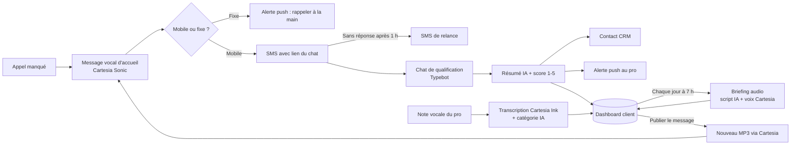
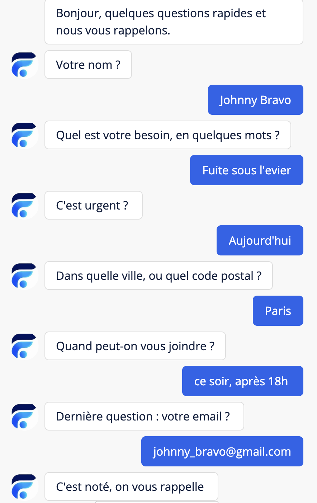
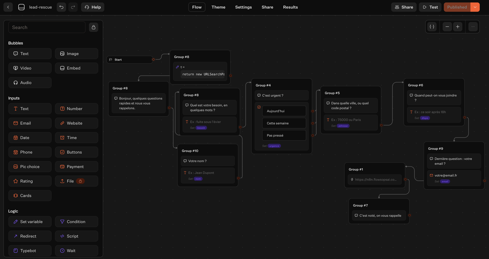
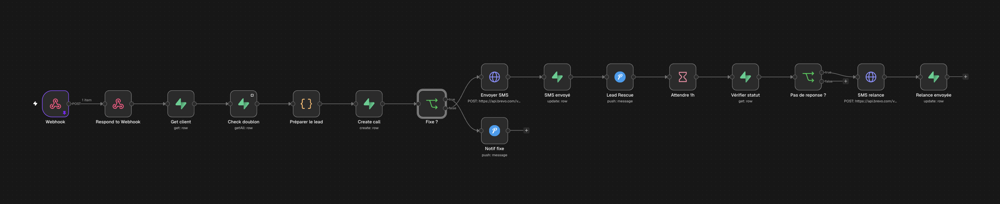
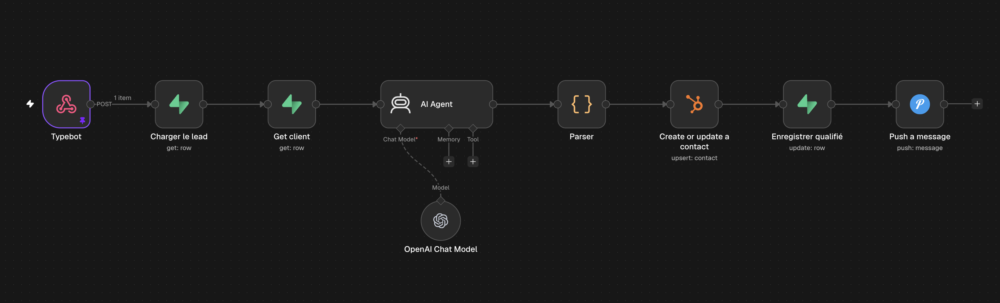
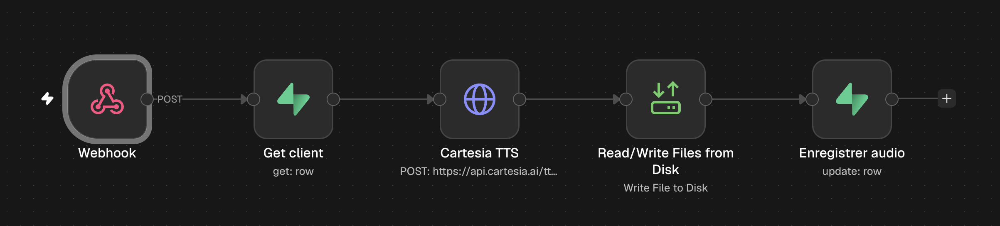
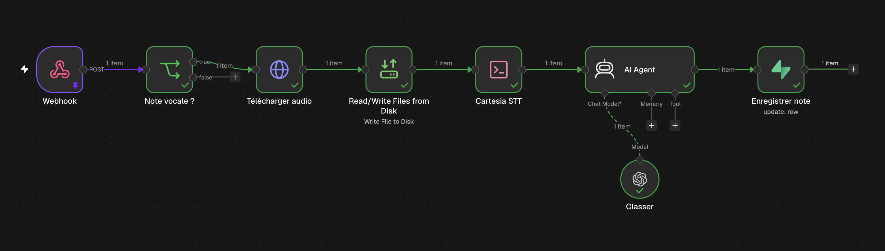
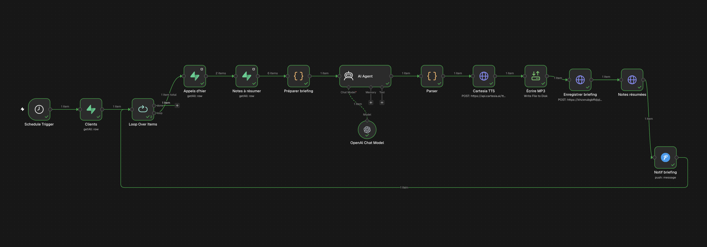
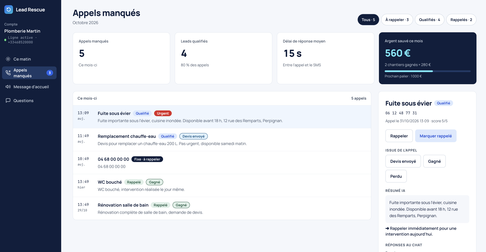

# Lead Rescue

🇬🇧 [Read in English](README.md)

**Récupération d'appels manqués pour les artisans et commerces locaux.** Quand un artisan ne peut pas décrocher, Lead Rescue répond en moins de 30 secondes : l'appelant reçoit un SMS avec un court chat de qualification piloté par l'IA, et le professionnel reçoit sur son téléphone et dans son CRM un résumé prêt à rappeler.

Conçu et exploité par [Thomas Plasseraud](https://www.linkedin.com/in/thomas-plasseraud) · FlowsOps AI.

---

## Le problème

Plombiers, paysagistes, couvreurs et garagistes ratent des appels toute la journée parce qu'ils sont sur un chantier. La plupart des appelants ne laissent pas de message vocal : ils appellent le concurrent suivant. Chaque appel manqué est un chantier perdu.

## Fonctionnement

1. **Renvoi d'appel** : le professionnel garde son numéro ; les appels sans réponse sont renvoyés (renvoi conditionnel) vers une ligne Lead Rescue.
2. **Réponse immédiate** : l'appelant entend le message d'accueil de l'entreprise, dans sa propre voix (générée avec Cartesia Sonic), et reçoit un SMS en quelques secondes.
3. **Chat de qualification** : un chat mobile demande de quel chantier il s'agit, l'urgence, le lieu et le meilleur moment pour rappeler.
4. **Résumé IA** : un LLM transforme les réponses en synthèse de 3 lignes, niveau d'urgence, score de 1 à 5 et action recommandée.
5. **Livraison** : le professionnel reçoit une notification push (🔴 si urgent) et un contact CRM est créé ou mis à jour.
6. **Relance** : si le lien n'est pas ouvert dans l'heure, un second SMS part automatiquement.

## Architecture

| Couche | Outil |
|---|---|
| Téléphonie | Telnyx (TeXML) |
| Message d'accueil (TTS) | Cartesia Sonic 3.6 : voix française, générée par client |
| Notes vocales (STT) | Cartesia Ink Whisper : transcription française |
| Orchestration | n8n (auto-hébergé, Docker, VPS Hetzner) |
| Base de données | Supabase (Postgres, multi-client avec Row Level Security) |
| SMS | Brevo SMS transactionnel |
| Chat de qualification | Typebot (lié à chaque appel par un token) |
| Résumé et scoring IA | OpenAI GPT-4o via AI Agent n8n |
| Dashboard client | Next.js + Tailwind sur Vercel |
| CRM | HubSpot |
| Alertes au pro | Pushover |

### Chat de qualification

  
  &nbsp;
  

Le SMS renvoie vers un chat mobile construit avec **Typebot**. Le token unique de l'appel voyage dans l'URL (`?t=…`) : chaque réponse est rattachée au bon appel manqué sans redemander l'identité de l'appelant.

1. **Nom**
2. **Besoin** : le chantier, en quelques mots
3. **Urgence** : aujourd'hui / cette semaine / pas pressé (un seul tap)
4. **Lieu** : ville ou code postal
5. **Meilleur moment pour rappeler**
6. **Email** (facultatif)

À la dernière réponse, Typebot envoie tout à WF2, qui rédige le résumé IA, note le lead et alerte le professionnel. L'appelant reçoit aussitôt un message « on vous rappelle ».

### Workflows

- **[`n8n/wf1-missed-call.json`](n8n/wf1-missed-call.json)** : appel manqué → recherche du client → dédoublonnage 24 h → détection des fixes → SMS → alerte push → attente 1 h → SMS de relance.
- **[`n8n/wf2-qualification.json`](n8n/wf2-qualification.json)** : réponses du chat → chargement de l'appel → résumé et score IA → HubSpot → enregistrement de la qualification → alerte push.
- **[`n8n/wf3-publish-voice.json`](n8n/wf3-publish-voice.json)** : déclenché par le bouton **Publier** du dashboard (webhook authentifié) : texte du message → TTS Cartesia Sonic → MP3 stocké sur le serveur → `audio_url` enregistrée ; WF1 joue le message propre à chaque client.
- **[`n8n/wf4-transcribe-notes.json`](n8n/wf4-transcribe-notes.json)** : déclenché par un Database Webhook Supabase à chaque nouvelle note : note vocale téléchargée depuis le stockage privé → transcription Cartesia Ink Whisper → catégorie IA (rappeler / commander / à faire / autre) → note marquée prête dans le dashboard.
- **[`n8n/wf5-morning-briefing.json`](n8n/wf5-morning-briefing.json)** : chaque jour à 7 h (heure de Paris), pour chaque client : appels manqués de la veille + notes non lues → appel prioritaire choisi (urgent d'abord, puis score) → l'IA rédige un résumé écrit et un script parlé de 60 mots → MP3 Cartesia Sonic dans la voix choisie → briefing enregistré (upsert idempotent) → notes marquées comme traitées → notification push.

### Modèle de données

**[`supabase/schema.sql`](supabase/schema.sql)** : un seul projet Supabase sert tous les clients :

- `clients` : une ligne par entreprise (numéro de rescue, modèle de SMS, message vocal, relance, panier moyen).
- `calls` : chaque appel manqué avec son cycle de vie complet (`missed → sms_sent → qualified → called_back`), horodatages, réponses du chat, résumé IA, score et ID du contact CRM.
- `questions` : six emplacements de questions de qualification configurables par client.
- `notes` : notes vocales et écrites saisies depuis le dashboard, avec transcription, catégorie et statut (`pending → ready`) ; l'audio est dans un bucket privé `voice-notes` cloisonné par client.
- `briefings` : un briefing du matin par client et par jour (résumé, audio, chiffres, appel prioritaire).
- `monthly_stats` : vue qui alimente les indicateurs du dashboard (appels manqués, leads qualifiés, délai de réponse, chiffre d'affaires récupéré estimé).

La Row Level Security garantit que chaque client ne voit que ses propres données. n8n écrit avec le service role ; le dashboard lit avec l'authentification de l'utilisateur.

## Dashboard client

**[`dashboard/`](dashboard/)** : Next.js 15 + Tailwind + Supabase Auth, déployé sur Vercel. Chaque professionnel se connecte et ne voit que ses données.

- **Ce matin** : briefing audio quotidien (voix Cartesia), le lead à rappeler en premier, les chiffres de la veille, notes vocales et écrites de la journée
- **Appels manqués** : chaque appel avec son statut, résumé IA, réponses du chat, lien CRM en un clic, bascule *rappelé* et issue (devis envoyé / gagné / perdu) qui alimente un compteur « argent récupéré » en direct
- **Message vocal** : modification du message, du SMS et de la relance ; **Publier** régénère le MP3 via WF3
- **Questions** : six emplacements de qualification : texte, type de réponse, activation, ordre

## Choix de conception

- **Multi-client dès le départ** : intégrer un nouveau client, c'est une ligne dans `clients`, pas un workflow dupliqué.
- **Pas de double SMS** : un même appelant n'est traité qu'une fois par 24 h.
- **Fixes gérés** : un fixe français ne peut pas recevoir de SMS ; le pro reçoit donc une alerte « rappeler à la main » au lieu d'un message perdu.
- **IA factuelle** : le modèle est contraint à du JSON strict et il lui est interdit d'inventer des informations ou de gonfler l'urgence.
- **Message d'accueil pré-généré, pas à chaque appel** : le MP3 n'est régénéré que si le texte change ; l'appelant l'entend instantanément, ça ne coûte rien par appel, et les appels sont toujours pris en charge si l'API TTS est en panne.
- **Notes pilotées par les événements** : un Database Webhook Supabase envoie chaque nouvelle note à n8n dès son enregistrement, sans polling.
- **STT via un client HTTP simple** : le nœud HTTP de n8n ne produit pas un envoi multipart que Cartesia accepte ; WF4 envoie donc l'audio avec le `fetch` + `FormData` natifs de Node depuis un nœud Execute Command ; la clé API est lue dans l'environnement du conteneur, jamais stockée dans le workflow.
- **Un briefing, pas un rapport** : le résumé du matin est écrit pour être *écouté*, en moins de 30 secondes, par quelqu'un qui roule vers un chantier ; l'IA reçoit une structure stricte et n'a pas le droit d'inventer.
- **Les secrets restent dans n8n** : chaque clé API est dans les credentials chiffrés de n8n ; les workflows exportés n'en contiennent aucune.

## Feuille de route

- [x] Dashboard client : appels manqués, réponses du chat, lien CRM en un clic, issues, message vocal et questions modifiables
- [x] Notes vocales et écrites depuis le dashboard
- [x] Transcription des notes vocales (Cartesia Ink Whisper) et catégorisation automatique
- [x] Briefing audio de 7 h dans la voix de l'entreprise
- [x] Message d'accueil généré avec **Cartesia Sonic** (voix françaises), régénéré à la publication
- [ ] Questions de qualification dynamiques lues depuis Supabase
- [ ] Rapport hebdomadaire par email pour chaque client
- [ ] Email de relance à 90 jours avec offre de parrainage (avec consentement, via Brevo)

## L'installer soi-même

1. Créer un projet Supabase et exécuter [`supabase/schema.sql`](supabase/schema.sql).
2. Importer les workflows dans n8n et y rattacher vos propres credentials (Supabase, Brevo, OpenAI, HubSpot, Pushover, Cartesia).
3. Remplacer `YOUR_PUSHOVER_USER_KEY` et pointer votre numéro Telnyx et le webhook Typebot vers les URL de production de n8n.
4. Insérer une ligne dans `clients` avec votre numéro de rescue.
5. Pour WF4 : définir `NODES_EXCLUDE=[]` et `CARTESIA_API_KEY` dans l'environnement du conteneur n8n, puis ajouter un Database Webhook Supabase sur `notes` (INSERT) vers l'URL de production de WF4 avec l'en-tête `x-lead-rescue-secret`.

---

© FlowsOps AI. Tous droits réservés. Voir [LICENSE](LICENSE).
