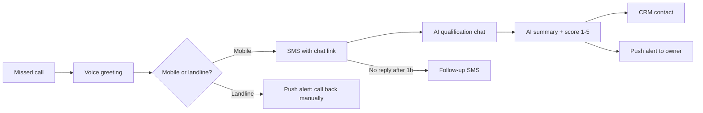

# Lead Rescue

**Missed-call recovery for local businesses.** When a tradesperson can't pick up, Lead Rescue answers in under 30 seconds: the caller gets an SMS with a short AI qualification chat, and the business owner gets a ready-to-call summary on their phone and in their CRM.

Built and operated by [Thomas Plasseraud](https://www.linkedin.com/in/thomas-plasseraud) · FlowsOps AI.

---

## The problem

Plumbers, landscapers, roofers and garages miss calls all day because they're on a job. Most callers don't leave a voicemail — they call the next business on the list. Every missed call is a lost job.

## How it works

1. **Call forwarding** — the business keeps its number; unanswered calls are forwarded (conditional forwarding) to a Lead Rescue line.
2. **Instant response** — the caller hears a short voice message and receives an SMS within seconds.
3. **Qualification chat** — a mobile chat asks what the job is, how urgent, where, and when to call back.
4. **AI summary** — an LLM turns the answers into a 3-line brief, an urgency level, a 1–5 lead score and a recommended next action.
5. **Delivery** — the owner gets a push notification (flagged 🔴 if urgent) and a CRM contact is created or updated.
6. **Follow-up** — if the link isn't opened within an hour, a second SMS is sent automatically.

## Architecture

| Layer | Tool |
|---|---|
| Telephony & voice greeting | Telnyx (TeXML) |
| Orchestration | n8n (self-hosted, Docker, Hetzner VPS) |
| Database | Supabase (Postgres, multi-tenant with Row Level Security) |
| SMS | Brevo transactional SMS |
| Qualification chat | Typebot |
| AI summary & scoring | OpenAI GPT-4o via n8n AI Agent |
| CRM | HubSpot |
| Owner alerts | Pushover |

### Workflows

- **[`n8n/wf1-missed-call.json`](n8n/wf1-missed-call.json)** — missed call → client lookup → 24h dedup → landline detection → SMS → push alert → 1h wait → follow-up SMS.
- **[`n8n/wf2-qualification.json`](n8n/wf2-qualification.json)** — chat answers → load call → AI summary & score → HubSpot → save qualification → push alert.

### Data model

**[`supabase/schema.sql`](supabase/schema.sql)** — one Supabase project serves every client:

- `clients` — one row per business: rescue number, SMS template, voice message, follow-up setting, average job value.
- `calls` — every missed call with its full lifecycle (`missed → sms_sent → qualified → called_back`), timestamps, chat answers, AI summary, score and CRM contact ID.
- `questions` — six configurable qualification slots per client.
- `monthly_stats` — view powering the dashboard KPIs (missed calls, qualified leads, response time, estimated revenue recovered).

Row Level Security ensures each client only ever sees its own data. n8n writes with the service role; the client dashboard reads with user auth.

## Design choices

- **Multi-tenant from day one** — onboarding a new client is one row in `clients`, not a duplicated workflow.
- **No double-texting** — the same caller is only processed once per 24h.
- **Landlines handled** — French landlines can't receive SMS, so the owner gets a "call back manually" alert instead of a wasted message.
- **Factual AI** — the model is constrained to strict JSON and forbidden from inventing information or inflating urgency.
- **Secrets stay in n8n** — every API key lives in encrypted n8n credentials; exported workflows contain none.

## Roadmap

- [ ] Client dashboard — missed calls, chat answers, one-click CRM link, editable voice message and questions
- [ ] Voice greeting generated with **Cartesia Sonic** (French voices), regenerated on publish
- [ ] Dynamic qualification questions read from Supabase
- [ ] Weekly email report per client
- [ ] Confirmation email to the prospect

## Running it yourself

1. Create a Supabase project and run [`supabase/schema.sql`](supabase/schema.sql).
2. Import both workflows into n8n and attach your own credentials (Supabase, Brevo, OpenAI, HubSpot, Pushover).
3. Replace `YOUR_PUSHOVER_USER_KEY` and point your Telnyx number and Typebot webhook to the n8n production URLs.
4. Insert a row in `clients` with your rescue number.

---

© FlowsOps AI. All rights reserved.
