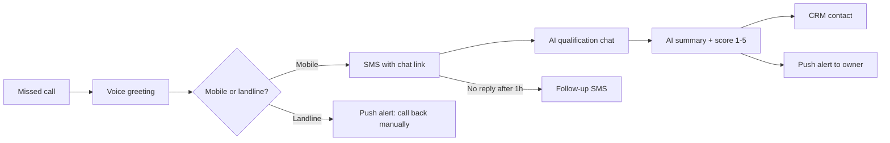
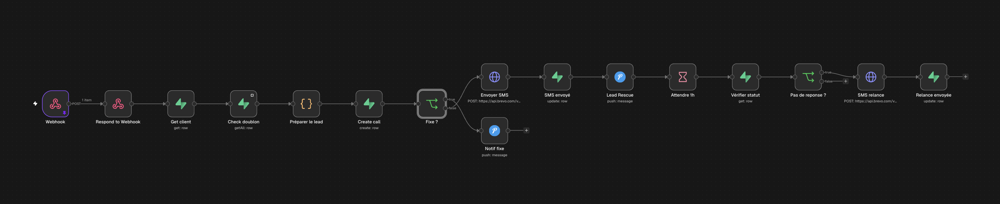
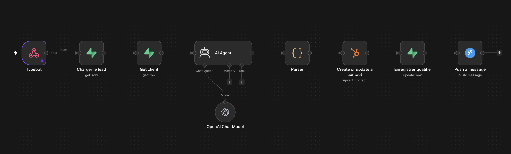
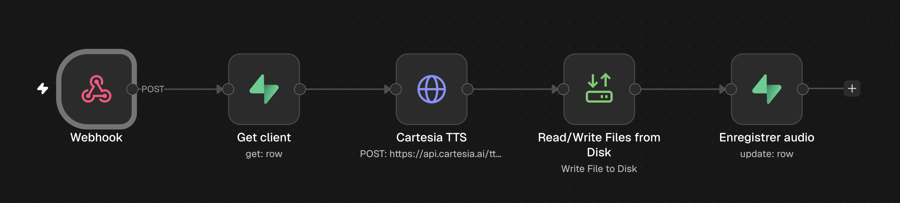
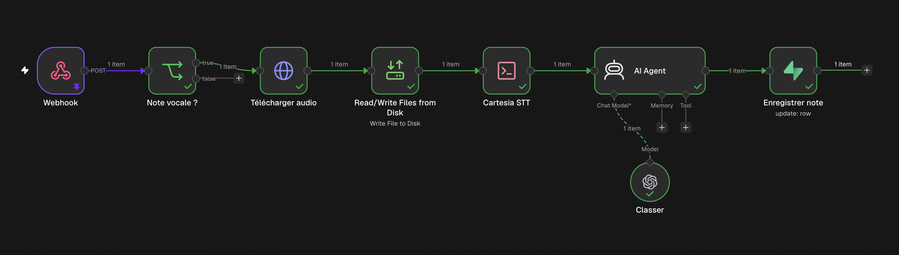
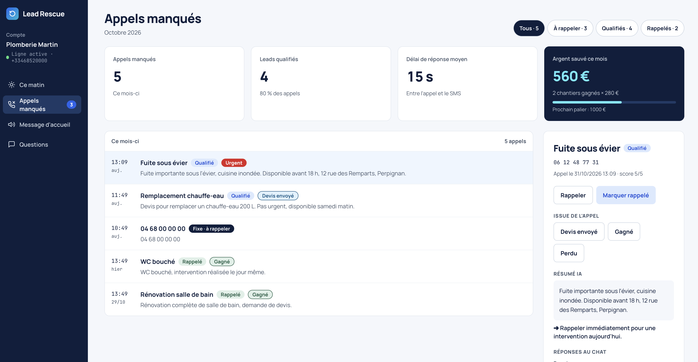

# Lead Rescue

**Missed-call recovery for local businesses.** When a tradesperson can't pick up, Lead Rescue answers in under 30 seconds: the caller gets an SMS with a short AI qualification chat, and the business owner gets a ready-to-call summary on their phone and in their CRM.

Built and operated by [Thomas Plasseraud](https://www.linkedin.com/in/thomas-plasseraud) · FlowsOps AI.

---

## The problem

Plumbers, landscapers, roofers and garages miss calls all day because they're on a job. Most callers don't leave a voicemail — they call the next business on the list. Every missed call is a lost job.

## How it works

1. **Call forwarding** — the business keeps its number; unanswered calls are forwarded (conditional forwarding) to a Lead Rescue line.
2. **Instant response** — the caller hears the business's own voice greeting (generated with Cartesia Sonic) and receives an SMS within seconds.
3. **Qualification chat** — a mobile chat asks what the job is, how urgent, where, and when to call back.
4. **AI summary** — an LLM turns the answers into a 3-line brief, an urgency level, a 1–5 lead score and a recommended next action.
5. **Delivery** — the owner gets a push notification (flagged 🔴 if urgent) and a CRM contact is created or updated.
6. **Follow-up** — if the link isn't opened within an hour, a second SMS is sent automatically.

## Architecture

| Layer | Tool |
|---|---|
| Telephony | Telnyx (TeXML) |
| Voice greeting (TTS) | Cartesia Sonic 3.6 — French voice, generated per client |
| Voice notes (STT) | Cartesia Ink Whisper — French transcription |
| Orchestration | n8n (self-hosted, Docker, Hetzner VPS) |
| Database | Supabase (Postgres, multi-tenant with Row Level Security) |
| SMS | Brevo transactional SMS |
| Qualification chat | Typebot |
| AI summary & scoring | OpenAI GPT-4o via n8n AI Agent |
| Client dashboard | Next.js + Tailwind on Vercel |
| CRM | HubSpot |
| Owner alerts | Pushover |

### Workflows

- **[`n8n/wf1-missed-call.json`](n8n/wf1-missed-call.json)** — missed call → client lookup → 24h dedup → landline detection → SMS → push alert → 1h wait → follow-up SMS.
- **[`n8n/wf2-qualification.json`](n8n/wf2-qualification.json)** — chat answers → load call → AI summary & score → HubSpot → save qualification → push alert.
- **[`n8n/wf3-publish-voice.json`](n8n/wf3-publish-voice.json)** — triggered by the dashboard's **Publish** button (authenticated webhook): client greeting text → Cartesia Sonic TTS → MP3 stored on the server → `audio_url` saved; WF1 plays each client's own greeting.
- **[`n8n/wf4-transcribe-notes.json`](n8n/wf4-transcribe-notes.json)** — triggered by a Supabase Database Webhook on every new note: voice note downloaded from private storage → Cartesia Ink Whisper transcription → AI category (call back / order / to-do / other) → note marked ready in the dashboard.

### Data model

**[`supabase/schema.sql`](supabase/schema.sql)** — one Supabase project serves every client:

- `clients` — one row per business: rescue number, SMS template, voice message, follow-up setting, average job value.
- `calls` — every missed call with its full lifecycle (`missed → sms_sent → qualified → called_back`), timestamps, chat answers, AI summary, score and CRM contact ID.
- `questions` — six configurable qualification slots per client.
- `notes` — voice and text notes captured from the dashboard, with transcription, category and status (`pending → ready`); audio lives in a private `voice-notes` storage bucket scoped per client.
- `briefings` — one morning briefing per client per day (summary, audio, stats, priority call).
- `monthly_stats` — view powering the dashboard KPIs (missed calls, qualified leads, response time, estimated revenue recovered).

Row Level Security ensures each client only ever sees its own data. n8n writes with the service role; the client dashboard reads with user auth.

## Client dashboard

**[`dashboard/`](dashboard/)** — Next.js 15 + Tailwind + Supabase Auth, deployed on Vercel. Each business logs in and only sees its own data.

- **This morning** — daily audio briefing (Cartesia voice), the lead to call back first, yesterday's numbers, voice and text notes captured during the day
- **Missed calls** — every call with its status, AI summary, chat answers, one-click CRM link, *called back* toggle and outcome (quote sent / won / lost) feeding a live "money saved" counter
- **Voice greeting** — edit the greeting, SMS and follow-up; **Publish** regenerates the MP3 through WF3
- **Questions** — six qualification slots: text, answer type, on/off, reorder

## Design choices

- **Multi-tenant from day one** — onboarding a new client is one row in `clients`, not a duplicated workflow.
- **No double-texting** — the same caller is only processed once per 24h.
- **Landlines handled** — French landlines can't receive SMS, so the owner gets a "call back manually" alert instead of a wasted message.
- **Factual AI** — the model is constrained to strict JSON and forbidden from inventing information or inflating urgency.
- **Greeting pre-generated, not per call** — the MP3 is regenerated only when the text changes, so callers hear it instantly, it costs nothing per call, and calls are still answered if the TTS API is down.
- **Event-driven notes** — a Supabase Database Webhook pushes each new note to n8n the moment it's saved; no polling.
- **STT through a plain HTTP client** — n8n's HTTP node doesn't produce a multipart upload Cartesia accepts, so WF4 sends the audio with Node's native `fetch` + `FormData` from an Execute Command node; the API key is read from the container environment, never stored in the workflow.
- **Secrets stay in n8n** — every API key lives in encrypted n8n credentials; exported workflows contain none.

## Roadmap

- [x] Client dashboard — missed calls, chat answers, one-click CRM link, outcomes, editable voice greeting and questions
- [x] Voice and text notes captured from the dashboard
- [x] Voice note transcription (Cartesia Ink Whisper) and automatic categorisation
- [ ] 7 a.m. audio briefing workflow
- [x] Voice greeting generated with **Cartesia Sonic** (French voices), regenerated on publish
- [ ] Dynamic qualification questions read from Supabase
- [ ] Weekly email report per client
- [ ] Confirmation email to the prospect

## Running it yourself

1. Create a Supabase project and run [`supabase/schema.sql`](supabase/schema.sql).
2. Import the workflows into n8n and attach your own credentials (Supabase, Brevo, OpenAI, HubSpot, Pushover, Cartesia).
3. Replace `YOUR_PUSHOVER_USER_KEY` and point your Telnyx number and Typebot webhook to the n8n production URLs.
4. Insert a row in `clients` with your rescue number.
5. For WF4: set `NODES_EXCLUDE=[]` and `CARTESIA_API_KEY` in the n8n container environment, then add a Supabase Database Webhook on `notes` (INSERT) pointing to the WF4 production URL with the `x-lead-rescue-secret` header.

---

© FlowsOps AI. All rights reserved.
